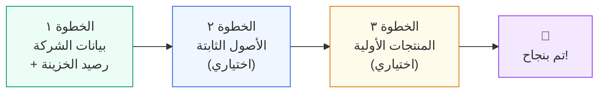

# 🎨 UI/UX Design System

> **Project:** Cloud Accounting & Inventory SaaS
> **Direction:** Arabic-First, RTL-Native, Calm & Professional
> **Last Updated:** November 2026

---

## Table of Contents

1. [Design Philosophy](#1-design-philosophy)
2. [Color System](#2-color-system)
3. [Typography](#3-typography)
4. [Spacing, Radius & Shadows](#4-spacing-radius--shadows)
5. [RTL Layout System](#5-rtl-layout-system)
6. [Shell Layout (Sidebar + Header)](#6-shell-layout-sidebar--header)
7. [Dashboard Page Design](#7-dashboard-page-design)
8. [Data Pages Pattern](#8-data-pages-pattern)
9. [Form Design](#9-form-design)
10. [Onboarding Wizard](#10-onboarding-wizard)
11. [Auth Pages](#11-auth-pages)
12. [Landing Page](#12-landing-page)
13. [Admin Portal](#13-admin-portal)
14. [Component Specifications](#14-component-specifications)
15. [States & Feedback](#15-states--feedback)
16. [Responsive Breakpoints](#16-responsive-breakpoints)
17. [Motion & Transitions](#17-motion--transitions)
18. [Iconography](#18-iconography)
19. [Currency & Number Formatting](#19-currency--number-formatting)
20. [Accessibility](#20-accessibility)

---

## 1. Design Philosophy

| Principle | How it Manifests in UI |
|---|---|
| **هادي (Calm)** | Muted backgrounds, generous whitespace, no visual noise. The interface breathes — information is layered, not crammed. |
| **Arabic-First** | Not a "flipped English app." Typography, spacing, and layouts are designed for Arabic reading flow from day one. |
| **Numbers in Focus** | Financial data is the hero. Large, clear, well-formatted numbers with currency. Supporting labels are quieter. |
| **One Action per Screen** | Each page has one primary purpose. Modals and drawers for secondary flows. No mode-switching with `useState`. |
| **Trustworthy** | Professional palette (emerald/slate). Consistent patterns. Confirmations before destructive or financial actions. |

### Design Mood

```
Calm        ████████████░░  (not playful, not corporate-cold)
Minimal     ██████████░░░░  (clean but not empty)
Professional████████████░░  (trustworthy, finance-grade)
Modern      ██████████████  (rounded cards, soft shadows, fresh)
```

---

## 2. Color System

### Core Palette

| Token | Tailwind Class | Hex | Usage |
|---|---|---|---|
| **Primary** | `emerald-600` | `#059669` | Buttons, active nav items, links, focus rings |
| **Primary Hover** | `emerald-700` | `#047857` | Button hover states |
| **Primary Soft** | `emerald-50` | `#ecfdf5` | Icon backgrounds, selected row highlights |
| **Background** | `slate-50` | `#f8fafc` | Page background behind all content |
| **Surface** | `white` | `#ffffff` | Cards, sidebar, header, modals |
| **Border** | `slate-200` | `#e2e8f0` | Card borders, table dividers, input borders |
| **Border Subtle** | `slate-100` | `#f1f5f9` | Inner dividers, secondary separators |

### Text Colors

| Token | Tailwind Class | Hex | Usage |
|---|---|---|---|
| **Text Primary** | `slate-900` | `#0f172a` | Headings, primary labels, important numbers |
| **Text Secondary** | `slate-600` | `#475569` | Body text, descriptions |
| **Text Muted** | `slate-400` | `#94a3b8` | Timestamps, helper text, placeholders |
| **Text On Primary** | `white` | `#ffffff` | Text on emerald buttons |

### Semantic Colors

| Token | Tailwind Class | Hex | Usage |
|---|---|---|---|
| **Positive** | `emerald-500` | `#10b981` | Income indicators, profit, stock increase |
| **Positive Soft** | `emerald-50` | `#ecfdf5` | Positive badge background |
| **Negative** | `rose-500` | `#f43f5e` | Expenses, deductions, delete actions |
| **Negative Soft** | `rose-50` | `#fff1f2` | Negative badge background |
| **Warning** | `amber-500` | `#f59e0b` | Low stock alerts, trial expiring |
| **Warning Soft** | `amber-50` | `#fffbeb` | Warning badge background |
| **Info** | `sky-500` | `#0ea5e9` | Funds Under Collection, pending states |
| **Info Soft** | `sky-50` | `#f0f9ff` | Info badge background |

### KPI Card Accent Colors

Each of the 5 primary KPI cards has its own accent to create visual hierarchy without breaking the calm aesthetic:

| KPI Card | Accent | Icon BG | Icon Color |
|---|---|---|---|
| الكاش في الخزينة | Emerald | `emerald-50` | `emerald-600` |
| قيمة البضاعة في المخزن | Blue | `blue-50` | `blue-600` |
| الأصول الثابتة | Violet | `violet-50` | `violet-600` |
| المصروفات العامة | Rose | `rose-50` | `rose-600` |
| صافي ربح الفترة | Amber | `amber-50` | `amber-600` |

### Dark Mode (Future)

Not in MVP scope. The design system uses CSS custom properties to enable future dark mode:

```css
/* Future-ready token structure */
--color-bg:      theme('colors.slate.50');
--color-surface: theme('colors.white');
--color-text:    theme('colors.slate.900');
```

---

## 3. Typography

### Font Family

| Use | Font | Fallback |
|---|---|---|
| **UI Text (Arabic + English)** | `IBM Plex Sans Arabic` | `system-ui`, `sans-serif` |
| **Numbers & Currency** | Same font + `tabular-nums` | — |

> **Why IBM Plex Sans Arabic:** Designed specifically for Arabic, excellent readability at all sizes, clear numerals, professional weight range, free via Google Fonts.

### Type Scale

| Token | Size | Weight | Line Height | Usage |
|---|---|---|---|---|
| **Display** | `text-3xl` (30px) | `font-bold` | `leading-tight` | Page hero numbers (dashboard KPIs) |
| **Heading 1** | `text-2xl` (24px) | `font-bold` | `leading-tight` | Page titles |
| **Heading 2** | `text-xl` (20px) | `font-semibold` | `leading-snug` | Section headers, card titles |
| **Heading 3** | `text-lg` (18px) | `font-semibold` | `leading-snug` | Subsection headers |
| **Body** | `text-base` (16px) | `font-normal` | `leading-relaxed` | General text, descriptions |
| **Body Small** | `text-sm` (14px) | `font-normal` | `leading-normal` | Table cells, form labels |
| **Caption** | `text-xs` (12px) | `font-medium` | `leading-normal` | Timestamps, badges, helper text |

### Number Display Rules

```
Financial amounts:  tabular-nums, font-semibold or font-bold
                    Always include currency suffix: "١٢,٣٤٥.٦٧ ج.م"

Table numbers:      tabular-nums, font-normal
                    Right-aligned within their column (in RTL, this is left-aligned visually)

Quantities:         tabular-nums, no currency
                    "١٥٠ قطعة"
```

---

## 4. Spacing, Radius & Shadows

### Spacing Scale

| Token | Value | Usage |
|---|---|---|
| **Page Padding** | `p-6` (24px) desktop / `p-4` (16px) mobile | Outer content padding |
| **Card Padding** | `p-6` (24px) | Inside card surfaces |
| **Card Gap** | `gap-6` (24px) | Between cards in a grid |
| **Section Gap** | `space-y-8` (32px) | Between major page sections |
| **Form Field Gap** | `space-y-4` (16px) | Between form fields |
| **Inline Gap** | `gap-3` (12px) | Between inline elements (icon + text) |
| **Tight Gap** | `gap-2` (8px) | Between badges, small items |

### Border Radius

| Element | Value | Tailwind |
|---|---|---|
| Cards & Panels | 12px | `rounded-xl` |
| Buttons | 8px | `rounded-lg` |
| Inputs & Selects | 6px | `rounded-md` |
| Badges & Tags | 9999px | `rounded-full` |
| Avatars | 9999px | `rounded-full` |

### Shadow System

| Level | Tailwind | Usage |
|---|---|---|
| **Resting** | `shadow-sm` | Default card state |
| **Hover** | `shadow-md` | Card on hover |
| **Elevated** | `shadow-lg` | Dropdowns, popovers |
| **Modal** | `shadow-xl` | Modal overlays, drawers |
| **None** | `shadow-none` | Flat elements, inner sections |

---

## 5. RTL Layout System

### Global Direction

```html
<html lang="ar" dir="rtl">
```

Every layout decision flows from RTL:

| Concept | LTR Default | Our RTL Implementation |
|---|---|---|
| Sidebar position | Left | **Right** |
| Text alignment | Left | **Right** (natural) |
| Icon placement | Before text (left) | **After text (right)** — use `flex-row-reverse` or Tailwind `rtl:` |
| Navigation flow | Left → Right | **Right → Left** |
| Table number alignment | Right | **Left** (numbers align opposite to text in RTL) |
| Progress steps | Left → Right | **Right → Left** (Step 1 on the right) |

### Tailwind RTL Utilities

```
Logical properties (preferred over physical):
├── ms-4  (margin-inline-start) instead of ml-4
├── me-4  (margin-inline-end) instead of mr-4
├── ps-4  (padding-inline-start) instead of pl-4
├── pe-4  (padding-inline-end) instead of pr-4
├── text-start instead of text-left
├── text-end instead of text-right
├── start-0 instead of left-0
├── end-0 instead of right-0
```

---

## 6. Shell Layout (Sidebar + Header)

### Desktop Layout (≥ 1024px)

```
┌──────────────────────────────────────────────────────────────────┐
│  ┌───────────────────────────────────────────────┐  ┌─────────┐ │
│  │  🔔  أحمد ◀             لوحة التحكم   Header │  │  Logo   │ │
│  │─────────────────────────────────────────────── │  │─────────│ │
│  │                                                │  │         │ │
│  │                                                │  │ 📊 لوحة │ │
│  │                                                │  │ 📦 مخزن │ │
│  │             Main Content Area                  │  │ 🛒 شراء │ │
│  │             (scrollable)                       │  │ 💰 بيع  │ │
│  │                                                │  │ 📋 مصروف│ │
│  │                                                │  │ 👤 مسحوب│ │
│  │                                                │  │ 📝 سجل  │ │
│  │                                                │  │         │ │
│  │                                                │  │─────────│ │
│  │                                                │  │ ⚙️ إعداد│ │
│  └────────────────────────────────────────────────┘  └─────────┘ │
│               ◄── Content area                      Sidebar ──► │
└──────────────────────────────────────────────────────────────────┘
```

### Sidebar Specification

```
Width:           w-64 (256px) expanded / w-16 (64px) collapsed (future)
Background:      bg-white
Border:          border-l border-slate-200 (left border in RTL = the inner edge)
Position:        Fixed right side

Nav Items:
├── Padding:     px-4 py-3
├── Active:      bg-emerald-50 text-emerald-700 font-medium rounded-lg
├── Hover:       bg-slate-50 rounded-lg
├── Default:     text-slate-600
├── Icon:        20x20 (w-5 h-5), me-3 gap from label
├── Font:        text-sm font-medium

Logo Area:
├── Height:      h-16
├── Padding:     px-6
├── Border:      border-b border-slate-100

Bottom Section:
├── Settings link pinned to bottom
├── Separated by border-t border-slate-100
```

### Header Specification

```
Height:          h-16 (64px)
Background:      bg-white
Border:          border-b border-slate-200
Position:        Sticky top

Content (RTL flow, right-to-left):
├── Page Title:  text-xl font-bold text-slate-900
├── Spacer:      flex-1
├── User Menu:   Avatar circle (32px) + name + dropdown chevron
```

### Mobile Layout (< 1024px)

```
┌──────────────────────────┐
│  ☰  Logo     🔔  👤     │  ← Sticky header with hamburger
│──────────────────────────│
│                          │
│    Main Content Area     │
│    (full width)          │
│                          │
│──────────────────────────│
│  📊  📦  💰  📋  ⚙️     │  ← Bottom tab bar (5 key items)
└──────────────────────────┘

Hamburger opens:
┌──────────────────────────┐
│  ✕                Logo   │
│──────────────────────────│
│  📊  لوحة التحكم         │
│  📦  المخزن              │
│  🛒  المشتريات           │
│  💰  المبيعات            │
│  📋  المصروفات           │
│  👤  المسحوبات           │
│  📝  سجل الحركات         │
│  ⚙️  الإعدادات           │
└──────────────────────────┘
← Slide-in sheet from the right (RTL)
← Overlay with bg-black/50 backdrop
```

---

## 7. Dashboard Page Design

### Visual Layout

```
┌──────────────────────────────────────────────────────────────┐
│                                                              │
│  ┌──────────┐ ┌──────────┐ ┌──────────┐ ┌──────────┐ ┌────────────┐
│  │ 💚       │ │ 💙       │ │ 💜       │ │ 💗       │ │ 💛         │
│  │ الكاش    │ │ المخزن   │ │ الأصول   │ │المصروفات │ │ صافي الربح │
│  │ في الخزينة│ │          │ │ الثابتة  │ │ العامة   │ │            │
│  │          │ │          │ │          │ │          │ │            │
│  │ ٤٥,٠٠٠  │ │ ١٢٣,٠٠٠ │ │ ٥٠,٠٠٠  │ │ ٨,٥٠٠   │ │ ٢٨,٥٠٠    │
│  │ ج.م      │ │ ج.م      │ │ ج.م      │ │ ج.م      │ │ ج.م        │
│  └──────────┘ └──────────┘ └──────────┘ └──────────┘ └────────────┘
│                                                              │
│  ┌──────────────────────────────────────────────────────────┐│
│  │  📥 فلوس تحت التحصيل: ٤,٥٠٠ ج.م  │  👤 المسحوبات: ٢,٠٠٠ ج.م  ││
│  └──────────────────────────────────────────────────────────┘│
│                                                              │
│  ┌──────────────────────────────────────────────────────────┐│
│  │  🤖  اكتب عملية بالعربي...            ⬅️ إرسال         ││
│  └──────────────────────────────────────────────────────────┘│
│                                                              │
│  ┌──────────────────────────────────────────────────────────┐│
│  │  آخر ١٠ حركات                                          ││
│  │  ┌─────────┬──────────┬───────────────────┬───────────┐ ││
│  │  │ الوقت   │ النوع    │ الوصف             │ المبلغ    │ ││
│  │  ├─────────┼──────────┼───────────────────┼───────────┤ ││
│  │  │ ١٢:٣٠  │ 🟢 بيع   │ بيع ١٠ تيشيرت    │ +١,٥٠٠   │ ││
│  │  │ ١١:١٥  │ 🔴 شراء  │ شراء بضاعة جديدة  │ -٤,٥٠٠   │ ││
│  │  │ ١٠:٠٠  │ 🟡 مصروف │ إيجار المحل       │ -٣,٠٠٠   │ ││
│  │  └─────────┴──────────┴───────────────────┴───────────┘ ││
│  └──────────────────────────────────────────────────────────┘│
│                                                              │
└──────────────────────────────────────────────────────────────┘
```

### KPI Card Anatomy

```
┌────────────────────────────────────┐
│                                    │
│  ┌────┐                           │
│  │icon│   الكاش في الخزينة        │   ← Label: text-sm text-slate-500
│  │ 💰 │                           │
│  └────┘                           │
│         ٤٥,٠٠٠.٠٠ ج.م            │   ← Value: text-2xl font-bold text-slate-900
│                                    │      tabular-nums
│                                    │
└────────────────────────────────────┘

Specs:
├── Container:  bg-white rounded-xl shadow-sm border border-slate-100 p-6
├── Icon box:   w-10 h-10 rounded-lg flex items-center justify-center
│               bg-{accent}-50, icon color: {accent}-600
├── Label:      text-sm font-medium text-slate-500 mt-4
├── Value:      text-2xl font-bold text-slate-900 mt-1 tabular-nums
├── Grid:       grid-cols-1 sm:grid-cols-2 md:grid-cols-3 lg:grid-cols-5 gap-4
```

### Secondary Strip

```
┌───────────────────────────────────────────────────────────────┐
│                                                               │
│  📥 فلوس تحت التحصيل        ٤,٥٠٠.٠٠ ج.م                   │
│                              ─────────────                    │
│  👤 المسحوبات الشخصية        ٢,٠٠٠.٠٠ ج.م                   │
│                                                               │
└───────────────────────────────────────────────────────────────┘

Specs:
├── Container:  bg-slate-50 rounded-xl px-6 py-4 border border-slate-100
├── Layout:     flex flex-col sm:flex-row sm:justify-between gap-4
├── Each item:  flex items-center gap-3
├── Label:      text-sm text-slate-500
├── Value:      text-sm font-semibold text-slate-700 tabular-nums
```

### AI Smart Entry Bar

```
┌──────────────────────────────────────────────────────────────┐
│  🤖  اكتب عملية بالعربي...                        ⬅️ إرسال │
└──────────────────────────────────────────────────────────────┘

Specs:
├── Container:  bg-white rounded-xl shadow-sm border border-slate-200 p-2
├── Input:      flex-1 bg-transparent border-none text-base
│               placeholder: text-slate-400
│               focus: ring-0 (no default ring, container gets border-emerald-500)
├── Send btn:   bg-emerald-600 text-white rounded-lg p-2.5
│               hover: bg-emerald-700
│               disabled: opacity-50 (when empty)
├── Robot icon: text-slate-400 w-5 h-5 ms-2

After AI response — Preview Card:
┌──────────────────────────────────────────────────────────────┐
│  ┌──────────────────────────────────────────────────────────┐│
│  │  🧾 معاينة العملية                                      ││
│  │──────────────────────────────────────────────────────────││
│  │  النوع: فاتورة شراء                                      ││
│  │                                                          ││
│  │  المنتج         الكمية        سعر الوحدة      الإجمالي   ││
│  │  تيشيرت         ١٠٠          ٤٥.٠٠           ٤,٥٠٠.٠٠  ││
│  │                                                          ││
│  │  الإجمالي: ٤,٥٠٠.٠٠ ج.م                                 ││
│  │                                                          ││
│  │  ┌────────────────┐  ┌──────────┐                        ││
│  │  │  تأكيد وحفظ ✅ │  │  إلغاء ❌ │                        ││
│  │  └────────────────┘  └──────────┘                        ││
│  └──────────────────────────────────────────────────────────┘│
└──────────────────────────────────────────────────────────────┘

Preview Card Specs:
├── Container:  bg-emerald-50/50 rounded-xl border border-emerald-200 p-6 mt-4
├── Title:      text-base font-semibold text-slate-800
├── Table:      text-sm, alternating bg-white/bg-slate-50 rows
├── Total:      text-base font-bold text-slate-900 border-t border-slate-200 pt-3
├── Confirm:    bg-emerald-600 text-white rounded-lg px-6 py-2.5 font-medium
├── Cancel:     bg-white text-slate-600 border border-slate-300 rounded-lg px-6 py-2.5
```

### Recent Transactions Table

```
Specs:
├── Container:  bg-white rounded-xl shadow-sm border border-slate-100
├── Header:     px-6 py-4 border-b border-slate-100
│               text-lg font-semibold text-slate-800
├── Table:      w-full
├── Th:         text-xs font-medium text-slate-400 uppercase px-6 py-3
├── Td:         text-sm text-slate-600 px-6 py-4 border-b border-slate-50
├── Amount:     tabular-nums font-medium
│               Positive: text-emerald-600 (prefix "+")
│               Negative: text-rose-600 (prefix "-")
├── Type badge: text-xs font-medium px-2.5 py-0.5 rounded-full
│               بيع:    bg-emerald-50 text-emerald-700
│               شراء:   bg-blue-50 text-blue-700
│               مصروف:  bg-rose-50 text-rose-700
│               مسحوبات: bg-slate-100 text-slate-600
│               تحصيل:  bg-sky-50 text-sky-700
```

---

## 8. Data Pages Pattern

Every data page (`/inventory`, `/purchases`, `/sales`, `/expenses`, `/withdrawals`, `/audit-logs`) follows this consistent structure:

### Layout Template

```
┌──────────────────────────────────────────────────────────────┐
│                                                              │
│  المخزن                                 + إضافة منتج جديد   │
│  ───────────────────────────────────────────────────────────  │
│                                                              │
│  ┌─────────────────────────────────────────────────────────┐ │
│  │  🔍 بحث...                              فلتر ▼        │ │
│  └─────────────────────────────────────────────────────────┘ │
│                                                              │
│  ┌─────────────────────────────────────────────────────────┐ │
│  │  #  │ اسم المنتج  │ الكمية   │ سعر التكلفة │ سعر البيع │ │
│  │─────┼─────────────┼──────────┼─────────────┼───────────│ │
│  │  1  │ تيشيرت قطن  │ ⚠️ 8     │ 45.00       │ 150.00    │ │
│  │  2  │ بنطلون جينز │ 150      │ 120.00      │ 350.00    │ │
│  │  3  │ حزام جلد    │ 200      │ 25.00       │ 80.00     │ │
│  │─────┴─────────────┴──────────┴─────────────┴───────────│ │
│  │            ◄  ١  ٢  ٣  ...  ►                          │ │
│  └─────────────────────────────────────────────────────────┘ │
│                                                              │
└──────────────────────────────────────────────────────────────┘
```

### Page Header

```
Specs:
├── Layout:     flex items-center justify-between mb-8
├── Title:      text-2xl font-bold text-slate-900
├── Action btn: bg-emerald-600 text-white rounded-lg px-4 py-2.5
│               flex items-center gap-2
│               icon: Plus (w-4 h-4)
│               hover: bg-emerald-700
│               shadow-sm
```

### DataTable Component

```
Specs:
├── Container:  bg-white rounded-xl shadow-sm border border-slate-100 overflow-hidden
├── Search bar: px-4 py-3 border-b border-slate-100
│               input: w-full sm:w-80 bg-slate-50 rounded-md
├── Thead:      bg-slate-50/80
├── Th:         text-xs font-semibold text-slate-500 px-6 py-3.5
│               uppercase tracking-wide
├── Tbody tr:   hover:bg-slate-50/50 transition-colors
├── Td:         text-sm text-slate-600 px-6 py-4
├── Actions:    flex gap-1
│               Edit:   ghost button, text-slate-400 hover:text-emerald-600
│               Delete: ghost button, text-slate-400 hover:text-rose-500
├── Pagination: px-6 py-4 border-t border-slate-100
│               flex items-center justify-between
│               text-sm text-slate-500
```

### Badges in Tables

| Badge | Background | Text | Border |
|---|---|---|---|
| **مدفوع (Paid)** | `bg-emerald-50` | `text-emerald-700` | — |
| **تحت التحصيل (Pending)** | `bg-amber-50` | `text-amber-700` | — |
| **مخزون منخفض (Low Stock)** | `bg-amber-50` | `text-amber-700` | — |
| **نشط (Active)** | `bg-emerald-50` | `text-emerald-700` | — |
| **منتهي (Expired)** | `bg-rose-50` | `text-rose-700` | — |
| **تجريبي (Trial)** | `bg-sky-50` | `text-sky-700` | — |

---

## 9. Form Design

### General Form Layout

```
┌──────────────────────────────────────────────────────────────┐
│                                                              │
│  فاتورة شراء جديدة                                           │
│  ─────────────────                                           │
│                                                              │
│  ┌─────────────────────────────────────────────────────────┐ │
│  │                                                         │ │
│  │  المورد (اختياري)                                       │ │
│  │  ┌───────────────────────────────────────────────────┐  │ │
│  │  │                                                   │  │ │
│  │  └───────────────────────────────────────────────────┘  │ │
│  │                                                         │ │
│  │  الخزينة                                                │ │
│  │  ┌───────────────────────────────────────────────────┐  │ │
│  │  │  الخزينة الرئيسية                            ▼   │  │ │
│  │  └───────────────────────────────────────────────────┘  │ │
│  │                                                         │ │
│  │  ───── المنتجات ──────────────────────────────────────  │ │
│  │                                                         │ │
│  │  المنتج          الكمية         سعر الوحدة              │ │
│  │  ┌────────────┐  ┌──────────┐  ┌──────────┐    🗑️      │ │
│  │  │ تيشيرت    │  │ 100      │  │ 45.00    │             │ │
│  │  └────────────┘  └──────────┘  └──────────┘             │ │
│  │  ┌────────────┐  ┌──────────┐  ┌──────────┐    🗑️      │ │
│  │  │ بنطلون    │  │ 50       │  │ 120.00   │             │ │
│  │  └────────────┘  └──────────┘  └──────────┘             │ │
│  │                                                         │ │
│  │  + إضافة منتج آخر                                       │ │
│  │                                                         │ │
│  │  ─────────────────────────────────────────────────────  │ │
│  │  الإجمالي:                           ١٠,٥٠٠.٠٠ ج.م    │ │
│  │                                                         │ │
│  │  ┌──────────────────┐  ┌──────────────┐                 │ │
│  │  │   حفظ الفاتورة   │  │    إلغاء     │                 │ │
│  │  └──────────────────┘  └──────────────┘                 │ │
│  │                                                         │ │
│  └─────────────────────────────────────────────────────────┘ │
│                                                              │
└──────────────────────────────────────────────────────────────┘
```

### Input Field Specs

```
Default State:
├── Border:      border border-slate-300
├── Background:  bg-white
├── Text:        text-sm text-slate-900
├── Placeholder: text-slate-400
├── Radius:      rounded-md
├── Padding:     px-3 py-2.5
├── Height:      h-10

Focus State:
├── Border:      border-emerald-500
├── Ring:        ring-2 ring-emerald-500/20
├── Outline:     outline-none

Error State:
├── Border:      border-rose-500
├── Ring:        ring-2 ring-rose-500/20
├── Error text:  text-xs text-rose-500 mt-1

Disabled State:
├── Background:  bg-slate-100
├── Text:        text-slate-400
├── Cursor:      cursor-not-allowed

Label:
├── Font:        text-sm font-medium text-slate-700
├── Margin:      mb-1.5
├── Required:    * text-rose-500
```

### Button Variants

| Variant | Background | Text | Border | Usage |
|---|---|---|---|---|
| **Primary** | `bg-emerald-600 hover:bg-emerald-700` | `text-white` | — | Main actions (Save, Confirm) |
| **Secondary** | `bg-white hover:bg-slate-50` | `text-slate-700` | `border border-slate-300` | Cancel, secondary actions |
| **Destructive** | `bg-rose-600 hover:bg-rose-700` | `text-white` | — | Delete confirmations |
| **Ghost** | `bg-transparent hover:bg-slate-100` | `text-slate-600` | — | Table row actions, icon buttons |
| **Link** | `bg-transparent` | `text-emerald-600 hover:text-emerald-700` | — | Inline text links |

```
All buttons:
├── Padding:     px-4 py-2.5
├── Radius:      rounded-lg
├── Font:        text-sm font-medium
├── Transition:  transition-colors duration-150
├── Disabled:    opacity-50 cursor-not-allowed
├── Focus:       ring-2 ring-emerald-500/20 ring-offset-2
```

---

## 10. Onboarding Wizard

### Visual Flow



### Step Indicator

```
     ● ──────── ○ ──────── ○
   الخطوة ١    الخطوة ٢    الخطوة ٣

Specs:
├── Active dot:    w-3 h-3 bg-emerald-600 rounded-full
├── Inactive dot:  w-3 h-3 bg-slate-300 rounded-full
├── Completed dot: w-3 h-3 bg-emerald-600 rounded-full + ✓ icon
├── Line:          h-0.5 bg-slate-200 (completed: bg-emerald-600)
├── Label:         text-xs text-slate-500 mt-2 (active: text-emerald-600 font-medium)
```

### Page Layout

```
┌──────────────────────────────────────────────────────────────┐
│                                                              │
│                        Logo                                  │
│                                                              │
│              ● ──────── ○ ──────── ○                         │
│            الخطوة ١    الخطوة ٢    الخطوة ٣                  │
│                                                              │
│  ┌────────────────────────────────────────────────────────┐  │
│  │                                                        │  │
│  │  أهلاً بيك! خلينا نجهز حسابك 👋                       │  │
│  │                                                        │  │
│  │  اسم الشركة                                            │  │
│  │  ┌──────────────────────────────────────────────────┐  │  │
│  │  │  مثال: شركة النور للتجارة                        │  │  │
│  │  └──────────────────────────────────────────────────┘  │  │
│  │                                                        │  │
│  │  رصيد الخزينة الافتتاحي                                │  │
│  │  ┌──────────────────────────────────────────────────┐  │  │
│  │  │  0.00                                    ج.م    │  │  │
│  │  └──────────────────────────────────────────────────┘  │  │
│  │                                                        │  │
│  │                                   ┌─────────────────┐  │  │
│  │                                   │   التالي ←      │  │  │
│  │                                   └─────────────────┘  │  │
│  │                                                        │  │
│  └────────────────────────────────────────────────────────┘  │
│                                                              │
└──────────────────────────────────────────────────────────────┘

Center layout:
├── Max width:   max-w-lg mx-auto
├── Card:        bg-white rounded-2xl shadow-lg p-8 sm:p-10
├── Page bg:     bg-gradient-to-b from-slate-50 to-white min-h-screen
├── Steps 2 & 3: Include "تخطي" (Skip) link below the main button
```

---

## 11. Auth Pages

### Login / Register Layout

```
┌──────────────────────────────────────────────────────────────┐
│                                                              │
│            bg-gradient-to-br from-emerald-50 to-slate-50     │
│                                                              │
│                        ┌──────────┐                          │
│                        │   Logo   │                          │
│                        └──────────┘                          │
│                                                              │
│            ┌────────────────────────────────┐                 │
│            │                                │                 │
│            │        تسجيل الدخول            │                 │
│            │                                │                 │
│            │  البريد الإلكتروني              │                 │
│            │  ┌──────────────────────────┐  │                 │
│            │  │  example@email.com       │  │                 │
│            │  └──────────────────────────┘  │                 │
│            │                                │                 │
│            │  كلمة المرور                   │                 │
│            │  ┌──────────────────────────┐  │                 │
│            │  │  ••••••••           👁️   │  │                 │
│            │  └──────────────────────────┘  │                 │
│            │                                │                 │
│            │  ┌──────────────────────────┐  │                 │
│            │  │      تسجيل الدخول        │  │                 │
│            │  └──────────────────────────┘  │                 │
│            │                                │                 │
│            │  ─────── أو ────────           │                 │
│            │                                │                 │
│            │  ┌──────────────────────────┐  │  ← Phase 6 only │
│            │  │  G  الدخول بحساب Google  │  │                 │
│            │  └──────────────────────────┘  │                 │
│            │                                │                 │
│            │  ما عندكش حساب؟ سجل دلوقتي    │                 │
│            │                                │                 │
│            └────────────────────────────────┘                 │
│                                                              │
└──────────────────────────────────────────────────────────────┘

Specs:
├── Page:        min-h-screen flex items-center justify-center
├── Background:  bg-gradient-to-br from-emerald-50 to-slate-50
├── Card:        bg-white rounded-2xl shadow-lg p-8 w-full max-w-md
├── Title:       text-2xl font-bold text-center text-slate-900 mb-6
├── Divider:     flex items-center gap-3
│                line: flex-1 h-px bg-slate-200
│                text: text-sm text-slate-400
├── Google btn:  bg-white border border-slate-300 hover:bg-slate-50
│                text-slate-700 font-medium
├── Link text:   text-sm text-slate-500
│                link: text-emerald-600 hover:text-emerald-700 font-medium
```

---

## 12. Landing Page

### Sections

```
┌──────────────────────────────────────────────────────────────┐
│  Navbar:  Logo                   المميزات  الأسعار   دخول   │
│──────────────────────────────────────────────────────────────│
│                                                              │
│  Hero Section:                                               │
│  ┌──────────────────────────────────────────────────────────┐│
│  │                                                          ││
│  │  حاسب شغلك بذكاء                                        ││
│  │  نظام محاسبة سحابي مصمم لتجار الأونلاين                  ││
│  │  والمشاريع الصغيرة                                       ││
│  │                                                          ││
│  │  ┌────────────────────┐                                  ││
│  │  │ ابدأ تجربتك المجانية│                                  ││
│  │  └────────────────────┘                                  ││
│  │                                                          ││
│  │  ✓ ١٤ يوم مجاناً   ✓ بدون بطاقة ائتمان                  ││
│  │                                                          ││
│  └──────────────────────────────────────────────────────────┘│
│                                                              │
│  Features Grid (3 cols):                                     │
│  ┌────────────┐  ┌────────────┐  ┌────────────┐             │
│  │ 📊         │  │ 🤖         │  │ 📦         │             │
│  │ لوحة تحكم  │  │ مساعد ذكي  │  │ إدارة      │             │
│  │ شاملة      │  │ بالعربي    │  │ المخزون    │             │
│  └────────────┘  └────────────┘  └────────────┘             │
│                                                              │
│  Footer:  حقوق النشر © ٢٠٢٦                                 │
│                                                              │
└──────────────────────────────────────────────────────────────┘

Hero:
├── Background:  bg-gradient-to-b from-white to-emerald-50/30
├── Title:       text-4xl sm:text-5xl font-bold text-slate-900 text-center
├── Subtitle:    text-lg text-slate-600 text-center max-w-2xl mx-auto mt-4
├── CTA button:  bg-emerald-600 text-white text-lg px-8 py-4 rounded-xl
│                shadow-lg shadow-emerald-600/25 hover:bg-emerald-700
├── Trust line:  text-sm text-slate-400 flex gap-6 mt-4

Feature Card:
├── Container:   bg-white rounded-xl p-6 border border-slate-100
│                hover:shadow-md transition-shadow
├── Icon:        w-12 h-12 rounded-xl bg-emerald-50 text-emerald-600
│                flex items-center justify-center mb-4
├── Title:       text-lg font-semibold text-slate-800
├── Description: text-sm text-slate-500 leading-relaxed mt-2
```

---

## 13. Admin Portal

### Isolated Design

The admin portal (`/admin`) has a **slightly different visual treatment** to clearly distinguish it from the main app:

```
Differences from main app:
├── Header accent:   Indigo instead of Emerald
├── Active nav:      bg-indigo-50 text-indigo-700
├── Primary button:  bg-indigo-600 hover:bg-indigo-700
├── No sidebar:      Simple top nav (admin has fewer pages)
├── Background:      Same bg-slate-50
```

### Companies Table

```
┌──────────────────────────────────────────────────────────────┐
│  إدارة الشركات                                               │
│  ───────────────────────────────────────────────────────────  │
│                                                              │
│  ┌─────────────────────────────────────────────────────────┐ │
│  │  الشركة      │ المالك        │ الحالة    │ إجراء        │ │
│  │──────────────┼───────────────┼───────────┼──────────────│ │
│  │  شركة النور  │ أحمد محمد     │ 🟡 تجريبي │  تفعيل      │ │
│  │  متجر الأمل  │ سارة أحمد    │ 🟢 نشط    │  —          │ │
│  │  بيت الموضة  │ محمد علي     │ 🔴 منتهي  │  تفعيل      │ │
│  └──────────────┴───────────────┴───────────┴──────────────┘ │
│                                                              │
└──────────────────────────────────────────────────────────────┘

"تفعيل" button:
├── bg-indigo-600 text-white rounded-md px-3 py-1.5 text-sm
├── Opens confirmation dialog before activating
```

---

## 14. Component Specifications

### Confirm Dialog (Modal)

```
┌──────────────────────────────────────────┐
│                                          │   ← bg-black/50 overlay
│   ┌──────────────────────────────────┐   │
│   │                                  │   │
│   │  ⚠️  هل أنت متأكد؟              │   │
│   │                                  │   │
│   │  سيتم حذف هذا المنتج نهائياً.    │   │
│   │  هذا الإجراء لا يمكن التراجع عنه.│   │
│   │                                  │   │
│   │       ┌────────┐  ┌──────┐       │   │
│   │       │  حذف   │  │إلغاء │       │   │
│   │       └────────┘  └──────┘       │   │
│   │                                  │   │
│   └──────────────────────────────────┘   │
│                                          │
└──────────────────────────────────────────┘

Specs:
├── Overlay:     fixed inset-0 bg-black/50 z-50
├── Container:   bg-white rounded-2xl shadow-xl p-6 max-w-md mx-auto
│                animate-in fade-in zoom-in-95
├── Icon:        w-12 h-12 rounded-full bg-rose-50 text-rose-600
│                flex items-center justify-center mx-auto mb-4
├── Title:       text-lg font-semibold text-slate-900 text-center
├── Body:        text-sm text-slate-500 text-center mt-2
├── Actions:     flex gap-3 justify-center mt-6
├── Destructive: bg-rose-600 text-white rounded-lg px-4 py-2.5
├── Cancel:      bg-white border border-slate-300 rounded-lg px-4 py-2.5
```

### Empty State

```
┌──────────────────────────────────────────┐
│                                          │
│              📦                          │
│                                          │
│        لا توجد منتجات بعد                │
│   أضف أول منتج لبدء إدارة مخزونك        │
│                                          │
│        ┌──────────────────┐              │
│        │  + إضافة منتج    │              │
│        └──────────────────┘              │
│                                          │
└──────────────────────────────────────────┘

Specs:
├── Container:   py-16 flex flex-col items-center justify-center
├── Icon:        text-4xl mb-4 (or illustration)
├── Title:       text-lg font-semibold text-slate-700
├── Description: text-sm text-slate-400 mt-1
├── Action:      mt-4, primary button variant
```

### Loading Skeleton

```
┌──────────────────────────────────────────┐
│  ┌──────────────────────────────────┐    │
│  │  ░░░░░░░░░░░░░░░░░░░░░░░░░░░░░  │    │
│  │  ░░░░░░░░░░░░░░░                │    │
│  └──────────────────────────────────┘    │
│  ┌──────────────────────────────────┐    │
│  │  ░░░░░░░░░░░░░░░░░░░░░░░░░░░░░  │    │
│  │  ░░░░░░░░░░                     │    │
│  └──────────────────────────────────┘    │
└──────────────────────────────────────────┘

Specs:
├── Background:  bg-slate-200 rounded-md
├── Animation:   animate-pulse
├── Height:      match the element being loaded (h-4, h-6, h-10)
├── Usage:       loading.tsx in each route folder
```

### Toast Notifications

```
Position: bottom-left (in RTL = bottom-start)

Success:
├── bg-white border-s-4 border-emerald-500 shadow-lg rounded-lg px-4 py-3
├── Icon: CheckCircle (emerald-500)
├── Text: text-sm text-slate-700
├── Auto-dismiss: 3 seconds

Error:
├── bg-white border-s-4 border-rose-500 shadow-lg rounded-lg px-4 py-3
├── Icon: XCircle (rose-500)
├── Text: text-sm text-slate-700
├── Auto-dismiss: 5 seconds (or manual)
```

### Currency Display Component

```
Specs:
├── Wrapper:     inline-flex items-center gap-1
├── Number:      tabular-nums font-semibold
├── Currency:    text-slate-400 text-sm font-normal
├── Format:      "١٢,٣٤٥.٦٧ ج.م"
├── Positive:    text-emerald-600
├── Negative:    text-rose-600
├── Neutral:     text-slate-900
```

---

## 15. States & Feedback

### Interactive State Map

```
┌─────────────────────────────────────────────────────────┐
│                                                         │
│  Button States:                                         │
│  ┌─────────┐ ┌─────────┐ ┌─────────┐ ┌─────────┐      │
│  │ Default │ │ Hover   │ │ Active  │ │Disabled │      │
│  │ ░░░░░░░ │ │ ▓▓▓▓▓▓▓ │ │ ███████ │ │ ░░░░░░░ │      │
│  │         │ │ darker  │ │ darkest │ │ 50% opa │      │
│  └─────────┘ └─────────┘ └─────────┘ └─────────┘      │
│                                                         │
│  Input States:                                          │
│  ┌─────────┐ ┌─────────┐ ┌─────────┐ ┌─────────┐      │
│  │ Default │ │ Focus   │ │ Error   │ │Disabled │      │
│  │ slate   │ │ emerald │ │ rose    │ │ slate   │      │
│  │ border  │ │ ring    │ │ ring    │ │ bg-100  │      │
│  └─────────┘ └─────────┘ └─────────┘ └─────────┘      │
│                                                         │
│  Table Row:                                             │
│  ┌─────────┐ ┌─────────┐                               │
│  │ Default │ │ Hover   │                               │
│  │ white   │ │slate-50 │                               │
│  │         │ │ /50     │                               │
│  └─────────┘ └─────────┘                               │
│                                                         │
└─────────────────────────────────────────────────────────┘
```

### Form Validation Feedback

```
Inline validation (on blur):
├── Error message:   text-xs text-rose-500 mt-1
├── Example:         "هذا الحقل مطلوب" / "البريد الإلكتروني غير صحيح"
├── Input border:    border-rose-500 ring-2 ring-rose-500/20

Server-side errors (after submit):
├── Top banner:      bg-rose-50 border border-rose-200 rounded-lg p-4 mb-6
├── Icon:            AlertCircle text-rose-600
├── Message:         text-sm text-rose-700

Success feedback:
├── Toast notification (see Toast spec above)
├── Redirect to list page after successful create/edit
```

---

## 16. Responsive Breakpoints

| Breakpoint | Width | Layout Behavior |
|---|---|---|
| **Mobile** | < 640px (`sm`) | Single column, stacked cards, bottom tab bar, hamburger menu |
| **Tablet** | 640px–1023px (`md`) | 2-column KPI grid, sidebar hidden (hamburger), content expands |
| **Desktop** | ≥ 1024px (`lg`) | Full sidebar visible, 5-column KPI grid, optimal layout |
| **Wide** | ≥ 1280px (`xl`) | Max content width `max-w-7xl`, centered with auto margins |

### Mobile-Specific Adaptations

| Element | Desktop | Mobile |
|---|---|---|
| **Sidebar** | Fixed right, always visible | Hidden — hamburger opens sheet from right |
| **Bottom Nav** | Hidden | Fixed bottom bar with 5 key nav items |
| **KPI Cards** | 5-column grid | Stack to 1 column, horizontal scroll, or 2-column grid |
| **Data Tables** | Full table | Horizontal scroll with sticky first column |
| **Forms** | Card layout | Full-width, no card wrapper |
| **Page Padding** | `p-6` | `p-4` |
| **Action Buttons** | In page header | Fixed bottom bar or floating action button |

### Bottom Tab Bar (Mobile Only)

```
┌──────────────────────────────────────────┐
│   📊      📦      💰      📋      ⚙️    │
│  لوحة    مخزن    مبيعات  مصروف  إعدادات  │
└──────────────────────────────────────────┘

Specs:
├── Position:    fixed bottom-0 inset-x-0 z-40
├── Background:  bg-white border-t border-slate-200
├── Height:      h-16 (with safe area padding for notched phones)
├── Items:       flex justify-around items-center
├── Active:      text-emerald-600
├── Inactive:    text-slate-400
├── Icon:        w-5 h-5
├── Label:       text-xs mt-0.5
```

---

## 17. Motion & Transitions

### Principles

```
Speed:     Fast and functional — not decorative
Duration:  150ms for micro-interactions, 200ms for layout changes, 300ms for modals
Easing:    ease-out for entering, ease-in for exiting
```

### Transition Specs

| Element | Transition | Duration |
|---|---|---|
| **Button hover** | `transition-colors` | `duration-150` |
| **Card hover shadow** | `transition-shadow` | `duration-200` |
| **Sidebar nav active** | `transition-colors` | `duration-150` |
| **Modal enter** | `animate-in fade-in zoom-in-95` | `duration-200` |
| **Modal exit** | `animate-out fade-out zoom-out-95` | `duration-150` |
| **Sheet (mobile nav)** | `animate-in slide-in-from-right` | `duration-300` |
| **Toast enter** | `animate-in slide-in-from-bottom fade-in` | `duration-300` |
| **Toast exit** | `animate-out slide-out-to-bottom fade-out` | `duration-200` |
| **Skeleton pulse** | `animate-pulse` | Infinite |
| **Page transition** | None (SSR — instant navigation) | — |

---

## 18. Iconography

### Icon System

| Property | Value |
|---|---|
| **Library** | Lucide Icons (React) |
| **Default Size** | `w-5 h-5` (20px) |
| **Stroke Width** | 1.75 (default) |
| **Color** | Inherits from text color |

### Icon Assignment

| Context | Icon | Lucide Name |
|---|---|---|
| لوحة التحكم (Dashboard) | 📊 | `LayoutDashboard` |
| المخزن (Inventory) | 📦 | `Package` |
| المشتريات (Purchases) | 🛒 | `ShoppingCart` |
| المبيعات (Sales) | 💰 | `Banknote` |
| المصروفات (Expenses) | 📋 | `Receipt` |
| المسحوبات (Withdrawals) | 👤 | `UserMinus` |
| سجل الحركات (Audit Log) | 📝 | `ScrollText` |
| الإعدادات (Settings) | ⚙️ | `Settings` |
| الخزينة (Safe/Cashbox) | 🏦 | `Vault` |
| الأصول الثابتة (Fixed Assets) | 🏢 | `Building2` |
| صافي الربح (Net Profit) | 📈 | `TrendingUp` |
| فلوس تحت التحصيل (Funds) | 📥 | `Clock` |
| إضافة (Add) | ➕ | `Plus` |
| تعديل (Edit) | ✏️ | `Pencil` |
| حذف (Delete) | 🗑️ | `Trash2` |
| بحث (Search) | 🔍 | `Search` |
| إغلاق (Close) | ✕ | `X` |
| تأكيد (Confirm) | ✅ | `Check` |
| AI مساعد | 🤖 | `Sparkles` |
| تصدير (Export) | 📤 | `Download` |
| تنبيه (Alert) | ⚠️ | `AlertTriangle` |

---

## 19. Currency & Number Formatting

### Display Rules

| Format | Example | Usage |
|---|---|---|
| **Full Amount** | `١٢,٣٤٥.٦٧ ج.م` | KPI cards, invoice totals, form totals |
| **Compact Amount** | `١٢.٣ ألف ج.م` | Only if space is very tight (avoid if possible) |
| **Quantity** | `١٥٠` | Stock quantities, item counts |
| **Percentage** | `١٢%` | Future trend indicators |

### Formatting Rules

```
Locale:          ar-EG
Currency:        EGP
Currency symbol: ج.م (placed AFTER the number)
Decimal places:  2 (always, for financial amounts)
Thousands sep:   comma (,) → Arabic: (٬) or Western comma
Decimal sep:     period (.) → Arabic: (٫) or Western period
Negative:        prefix with "-" sign, text-rose-600
Positive income: prefix with "+" sign, text-emerald-600
```

### Implementation

```typescript
// Utility function used everywhere
function formatCurrency(amount: number): string {
  return new Intl.NumberFormat('ar-EG', {
    minimumFractionDigits: 2,
    maximumFractionDigits: 2,
  }).format(amount) + ' ج.م';
}
```

---

## 20. Accessibility

### Standards

| Requirement | Implementation |
|---|---|
| **Color Contrast** | All text meets WCAG AA (4.5:1 for body, 3:1 for large text) |
| **Focus Indicators** | Visible focus rings on all interactive elements (`ring-2 ring-emerald-500/20 ring-offset-2`) |
| **Keyboard Navigation** | All actions reachable via Tab / Enter / Escape |
| **Screen Reader** | Semantic HTML, `aria-label` on icon-only buttons, `role` on custom components |
| **Form Labels** | Every input has a visible `<label>` with `htmlFor` |
| **Error Announcements** | `aria-live="polite"` on error messages |
| **Language** | `lang="ar"` on `<html>` for correct screen reader pronunciation |
| **Touch Targets** | Minimum 44×44px for all interactive elements on mobile |

---

> **End of UI/UX Design Document**
>
> This document defines the visual and interaction design. For backend architecture, database schema, and business logic, see `Plan.md` and `Skills.md`.
